# Architecture: Operations Under Pressure

This document provides a comprehensive technical overview of the architecture, data model, concurrency guarantees, and operational characteristics of the Operations Under Pressure platform.

---

## 1. Overview

Operations Under Pressure is an operational work item management and incident triage system engineered for environments where multiple operators concurrently claim, edit, review, and transition critical work items. 

The architecture prioritizes correctness and data integrity over ad-hoc feature accumulation through four core principles:

1. **Correctness over Features**: Concurrency collisions, duplicate network deliveries, and race conditions are solved deterministically at the database layer using atomic conditional updates, entity versioning, and database-level unique constraints.
2. **Server-Side Authorization**: The client UI is treated as untrusted. Permissions are evaluated on every incoming request using a single centralized authorization engine. Client UI action flags (`allowedActions`) serve solely as visual guidance.
3. **Transactional History Integrity**: Work item state changes and their corresponding immutable audit logs (`activity_events`) are written inside the exact same database transaction. An append-only PostgreSQL trigger prevents updates or deletions to audit history.
4. **No In-Memory Filtering**: All searching, filtering, and keyset-based pagination are executed entirely within PostgreSQL via specialized composite and partial B-tree/GIN indexes. The server never streams unfiltered records into Node.js or browser memory.

---

## 2. System Context

The platform runs as four containerized services orchestrated via Docker Compose:

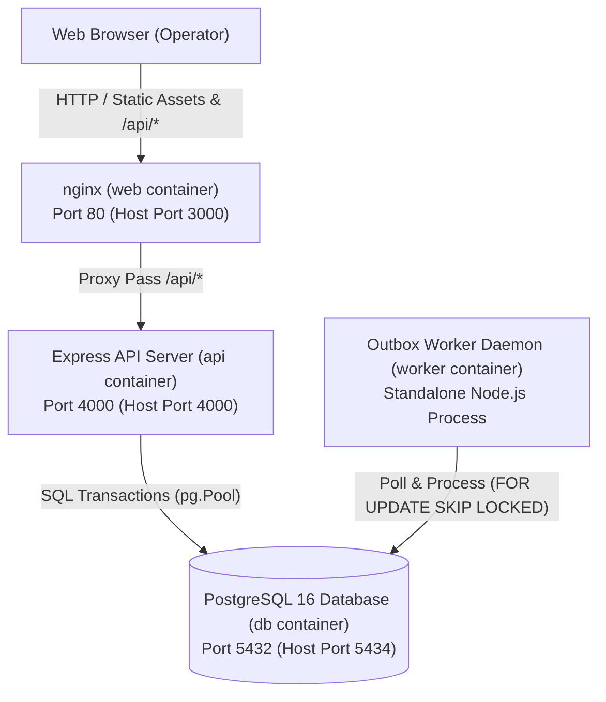

### Component Network Routing
- **Browser Client**: Interacts with the platform on host port `3000` via HTTP.
- **Nginx (`web`)**: Listens on port `80` (mapped to host `3000`). Serves precompiled static Single Page Application (SPA) assets and proxies `/api/*` requests upstream to `http://api:4000`.
- **API Server (`api`)**: Express application listening on port `4000` (mapped to host `4000`). Connects to PostgreSQL internally at `db:5432`.
- **Worker Daemon (`worker`)**: Standalone Node.js instance spawned with `npm run start:worker`. Shares the API container image, executing background outbox processing against `db:5432`.
- **PostgreSQL (`db`)**: PostgreSQL 16 listening on container port `5432` (mapped to host `5434` to preserve any native host PostgreSQL on 5433).

---

## 3. Component View

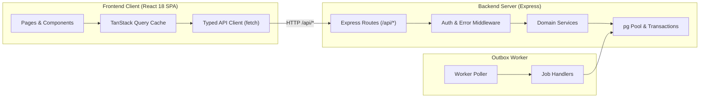

### Backend Layers
- **Routes ([backend/src/routes/](backend/src/routes/))**: Mounts Express routers for `auth`, `items`, `dashboard`, `teams`, and `notifications`. Validates request shapes using Zod schemas, extracts authentication contexts from `req.user`, and delegates work to domain services.
- **Middleware ([backend/src/middleware/](backend/src/middleware/))**: `requireAuth` in [auth.ts](backend/src/middleware/auth.ts) validates JWT bearer tokens and hydrates user profiles with team memberships. `errorHandler` in [error.ts](backend/src/middleware/error.ts) intercepts known `AppError` instances, formatting consistent JSON envelopes with HTTP status codes.
- **Services ([backend/src/services/](backend/src/services/))**: Encapsulates core business rules: [items.ts](backend/src/services/items.ts) (CRUD, claims, transitions), [permissions.ts](backend/src/services/permissions.ts) (authorization policy), [idempotency.ts](backend/src/services/idempotency.ts) (deduplication), [workflow.ts](backend/src/services/workflow.ts) (state machine transitions), [activity.ts](backend/src/services/activity.ts) (audit logging), and [outbox.ts](backend/src/services/outbox.ts) (job queue management).
- **Database Layer ([backend/src/db/](backend/src/db/))**: Manages the PostgreSQL connection pool ([pool.ts](backend/src/db/pool.ts)) and provides the `withTransaction` helper to ensure multi-step mutations execute atomically.
- **Worker Daemon ([backend/src/worker/](backend/src/worker/))**: An independent polling daemon running [worker.ts](backend/src/worker/worker.ts) and [handlers.ts](backend/src/worker/handlers.ts) that claims pending outbox jobs and delivers background notifications.

### Frontend Layers
- **Pages & Components ([frontend/src/pages/](frontend/src/pages/), [frontend/src/components/](frontend/src/components/))**: UI layer built with React 18, React Router 6, and Tailwind CSS. Organizes views for Dashboard, All Items, and Item Detail without third-party component libraries.
- **TanStack Query Cache**: Manages server state caching, background polling (15s interval), window refetching, and optimistic UI mutations with automated rollback.
- **API Client ([frontend/src/api/client.ts](frontend/src/api/client.ts))**: Typed HTTP client wrapping `window.fetch`. Automatically attaches JWT bearer tokens and `Idempotency-Key` headers, and unpacks structured `ApiError` payloads.

---

## 4. Deployment

The application is deployed with Docker Compose via [docker-compose.yml](docker-compose.yml):

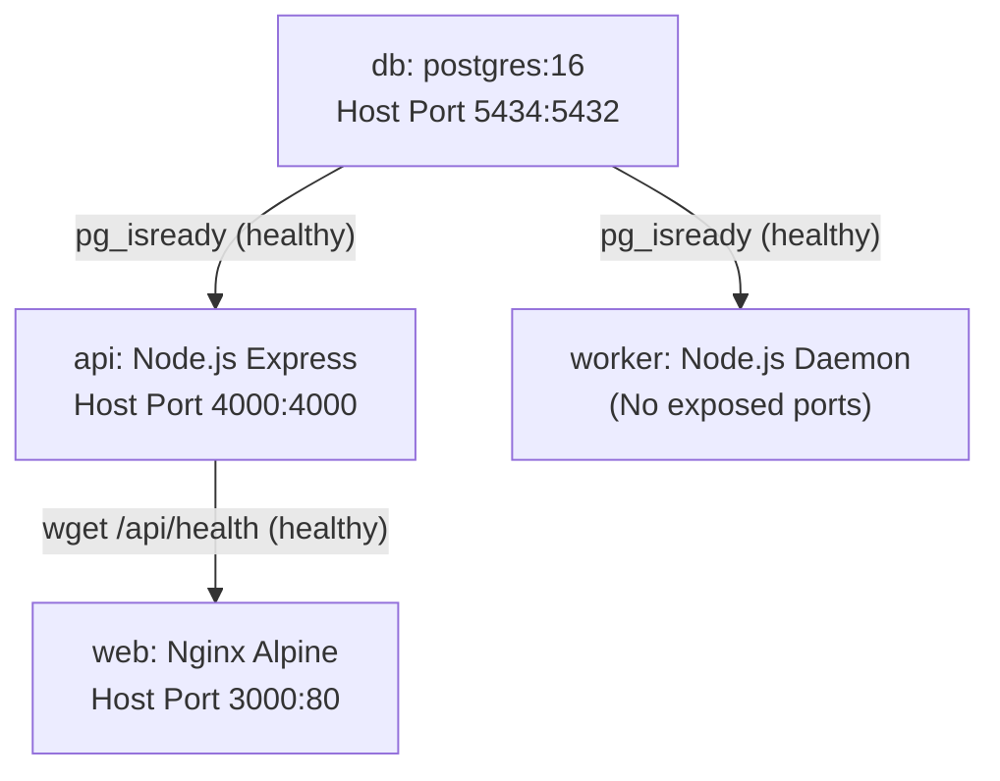

### Container Specifications
- **`db` (`postgres:16`)**:
  - Host port mapping: `${POSTGRES_PORT:-5434}:5432`.
  - Healthcheck: `pg_isready -U ops -d ops` every 5 seconds (5 retries, 5s timeout).
  - Storage: Named volume `pgdata` persisting PostgreSQL cluster data.
- **`api` (`backend/Dockerfile`)**:
  - Multi-stage build (`node:20-alpine` builder with `tsc` -> `node:20-alpine` runner).
  - Host port mapping: `4000:4000`.
  - Depends on: `db` (`condition: service_healthy`).
  - Healthcheck: `wget -qO- http://localhost:4000/api/health || exit 1` (5s interval, 15s start period).
  - Entry command: Executes `initDatabase()` in [backend/src/db/init.ts](backend/src/db/init.ts) before starting `dist/server.js`.
- **`worker` (`backend/Dockerfile`)**:
  - Uses the identical multi-stage image as `api`.
  - Command override: `npm run start:worker` (`dist/worker/worker.js`).
  - Depends on: `db` (`condition: service_healthy`).
- **`web` (`frontend/Dockerfile`)**:
  - Multi-stage build (`node:20-alpine` runs `vite build` -> `nginx:alpine` runner).
  - Host port mapping: `3000:80`.
  - Depends on: `api` (`condition: service_healthy`).
  - Nginx configuration: [frontend/nginx.conf](frontend/nginx.conf) routes `/api/` to `http://api:4000` and serves `index.html` fallback for client routes.

### Startup Database Lifecycle
When the `api` container boots, `initDatabase()` in [backend/src/db/init.ts](backend/src/db/init.ts) executes sequentially:
1. Calls `runMigrations()` in [backend/src/db/migrate.ts](backend/src/db/migrate.ts) to execute unapplied SQL scripts in `backend/migrations/` ordered by name.
2. Checks user table record count: `SELECT count(*) FROM users`.
3. If empty (`count === 0`), executes `seedDatabase()` in [backend/src/db/seed.ts](backend/src/db/seed.ts) to seed 4 teams, 6 demo operator accounts, and 5,000 realistic work items.
4. If records already exist, seeding is safely skipped to avoid overwriting persisted data.

---

## 5. Data Model

The schema is defined in [backend/migrations/001_init.sql](backend/migrations/001_init.sql):

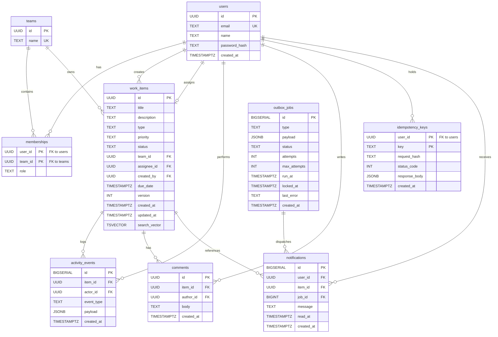

### Indexes and Query Profiles

| Index Name | Target Table & Definition | Purpose & Query Served |
| :--- | :--- | :--- |
| `idx_work_items_team_created_id` | `work_items(team_id, created_at DESC, id DESC)` | Keyset pagination for team-scoped list queries (`WHERE wi.team_id = ANY($1)`). |
| `idx_work_items_team_status_created_id` | `work_items(team_id, status, created_at DESC, id DESC)` | Filtered keyset pagination by item status. |
| `idx_work_items_assignee_active` | `work_items(assignee_id, created_at DESC, id DESC) WHERE status NOT IN ('resolved', 'closed')` | Partial index for the "Assigned to Me" queue and dashboard counter. |
| `idx_work_items_unassigned_urgent` | `work_items(team_id, created_at DESC, id DESC) WHERE assignee_id IS NULL AND priority = 'urgent' AND status NOT IN ('resolved', 'closed')` | Partial index for the "Unassigned Urgent" attention card and queue. |
| `idx_work_items_awaiting_approval` | `work_items(team_id, created_at DESC, id DESC) WHERE status = 'awaiting_approval'` | Partial index powering lead review queues and the "Awaiting My Approval" metric. |
| `idx_work_items_search_vector` | `work_items USING GIN(search_vector)` | Inverted full-text search index matching `search_vector @@ websearch_to_tsquery('english', $query)`. |
| `idx_activity_events_item_id` | `activity_events(item_id, id DESC)` | Keyset cursor pagination for item audit trail timelines (`WHERE ae.item_id = $1 AND ae.id < $2`). |
| `idx_comments_item_created` | `comments(item_id, created_at)` | Chronological loading of comments on an item. |
| `idx_memberships_team_id` | `memberships(team_id)` | Team member rosters and identifying leads/admins for approval alerts. |
| `idx_outbox_jobs_pending` | `outbox_jobs(run_at, id) WHERE status = 'pending'` | Partial index used by the worker polling query to find runnable jobs without full-table scans. |
| `idx_notifications_user_id` | `notifications(user_id, id DESC)` | Loading recent user notifications and unread counts. |

---

## 6. Workflow State Machine

The workflow state transitions are defined in [backend/src/services/workflow.ts](backend/src/services/workflow.ts):

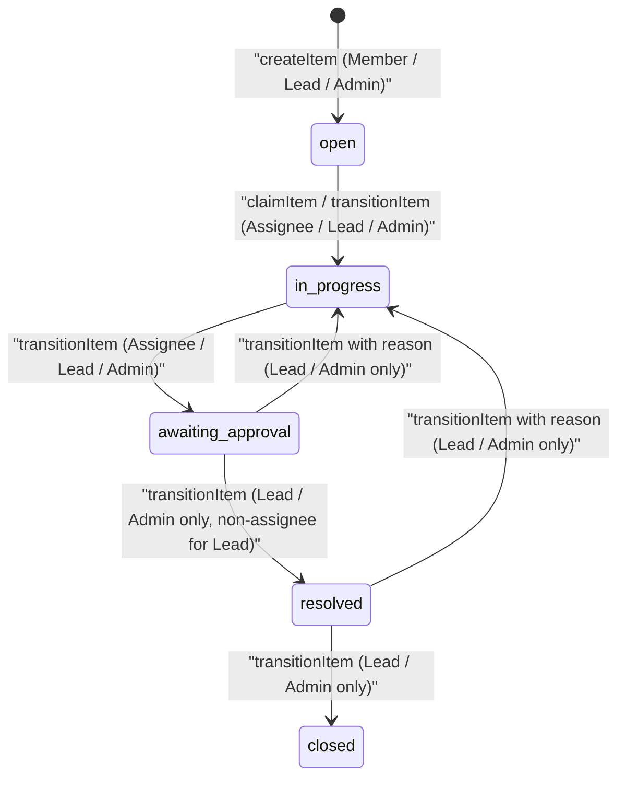

### Transition Matrix and Reason Requirements
- `open` $\rightarrow$ `in_progress`: Permitted for current assignee, team leads, or admins. Item must have an assignee.
- `in_progress` $\rightarrow$ `awaiting_approval`: Permitted for current assignee, team leads, or admins.
- `awaiting_approval` $\rightarrow$ `resolved`: Lead or Admin approval. **Self-approval rule**: Team leads cannot approve items assigned to themselves (Admin can).
- `awaiting_approval` $\rightarrow$ `in_progress`: Rejection. Requires a non-empty `reason` string logged in the audit event.
- `resolved` $\rightarrow$ `closed`: Final closing by Lead or Admin.
- `resolved` $\rightarrow$ `in_progress`: Reopening. Requires a non-empty `reason` string.
- `closed`: Terminal state (`ALLOWED_TRANSITIONS['closed'] = []`).

### Role by Action Permission Matrix

| Action | Viewer | Member | Lead | Admin | Rules Enforced |
| :--- | :---: | :---: | :---: | :---: | :--- |
| **Read Items & Activity** | Allowed | Allowed | Allowed | Allowed | Must be a member of the item's team. Non-members receive `403 FORBIDDEN`. |
| **Create Item** | Denied | Allowed | Allowed | Allowed | Viewers are strictly read-only. |
| **Claim Item** | Denied | Allowed | Allowed | Allowed | Item must be unassigned (`assignee_id IS NULL`) and in `open` or `in_progress` status. |
| **Assign / Reassign** | Denied | Denied | Allowed | Allowed | Target assignee must hold `member`, `lead`, or `admin` role in the team (not viewer). |
| **Edit Item Details** | Denied | Allowed (Scoped) | Allowed | Allowed | Members may only edit items they created or are assigned to. Finalized items (`resolved`/`closed`) are immutable. |
| **Add Comment** | Denied | Allowed | Allowed | Allowed | Viewers cannot comment. Members/leads/admins can comment even on closed items. |
| **Request Approval** | Denied | Allowed (Assignee) | Allowed (Assignee) | Allowed | Advances state from `in_progress` to `awaiting_approval`. |
| **Approve Item** | Denied | Denied | Allowed (Non-Assignee) | Allowed | Lead cannot approve an item assigned to themselves. Admin can approve any item. |
| **Reject Approval** | Denied | Denied | Allowed | Allowed | Rejection reverts to `in_progress` and requires a mandatory reason. |
| **Close / Reopen** | Denied | Denied | Allowed | Allowed | Reopening requires a mandatory reason. |

---

## 7. Authorization Model

Authorization in Operations Under Pressure is multi-tenant by team and strictly enforced on the server.

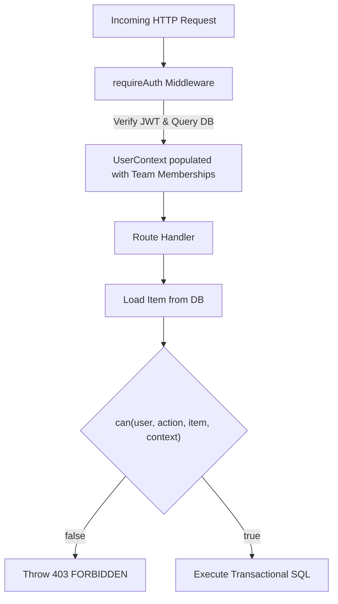

### Token Hydration & Membership Loading
Authentication occurs via signed JWT tokens containing `{ userId }` issued at `/api/auth/login`. In [backend/src/middleware/auth.ts](backend/src/middleware/auth.ts), `requireAuth` extracts the bearer token, verifies its signature against `config.jwtSecret`, and queries the database:
```sql
SELECT u.id, u.email, u.name, m.team_id, t.name AS team_name, m.role
FROM users u
LEFT JOIN memberships m ON u.id = m.user_id
LEFT JOIN teams t ON m.team_id = t.id
WHERE u.id = $1;
```
This populates `req.user` with the caller's complete profile and an array of all team memberships (`{ teamId, teamName, role }`).

### The Central `can()` Engine
Every authorization check flows through a single pure function in [backend/src/services/permissions.ts](backend/src/services/permissions.ts):
```typescript
can(user: UserContext, action: PermissionAction, item?: ItemContext, context?: TransitionContext): boolean
```
Routes and services never execute ad-hoc role comparisons. If a user does not have a membership record matching `item.team_id`, `can()` immediately returns `false`.

### 403 Forbidden vs 404 Not Found
- If an item does not exist in `work_items`, the API returns `404 NOT_FOUND`.
- If an item exists but the caller is not a member of the item's team, the API throws `403 FORBIDDEN` (`"You do not have access to this team item"`).
This enforces security logging while guaranteeing tenant isolation across all endpoints.

### Query Scoping to Caller's Teams
List queries ([listItems](backend/src/services/items.ts)) and dashboard aggregations ([getDashboardCounts](backend/src/services/items.ts)) dynamically inject `wi.team_id = ANY($teamIds)` where `$teamIds` is derived directly from `req.user.memberships`. A user cannot view or filter records outside their designated teams.

### Role of `allowedActions`
When returning work item details, the server invokes `getAllowedActions(user, item)` to attach an `allowedActions` object:
```json
{
  "edit": false,
  "comment": true,
  "claim": false,
  "assign": false,
  "transitions": []
}
```
**`allowedActions` is strictly a non-authoritative UI hint**. The frontend uses it to disable buttons or show informative tooltips. When an action is submitted, the API re-evaluates `can(user, action, item)` inside the database transaction; no client-provided permission flag is ever trusted.

---

## 8. Request Flows

### a. Claiming an Item
Atomic conditional update prevents dual-operator claiming races.

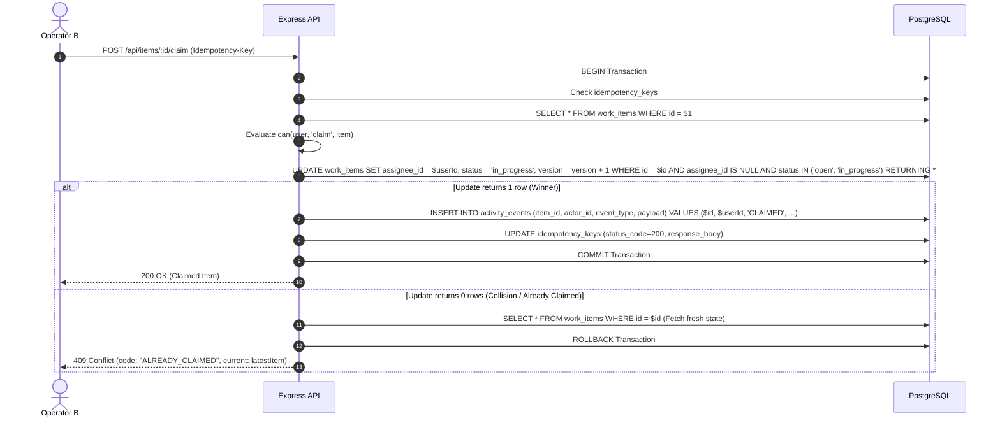

### b. Updating with Optimistic Concurrency Control (OCC)
Version-checked update prevents lost updates between simultaneous editors.

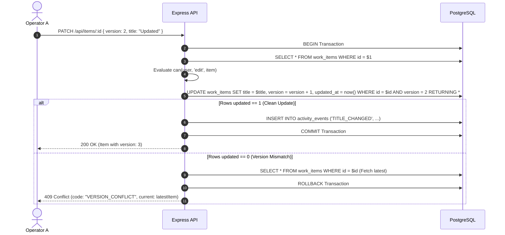

### c. Creating an Item with Idempotency-Key
Transaction-level deduplication prevents duplicate creations under retries or parallel requests.

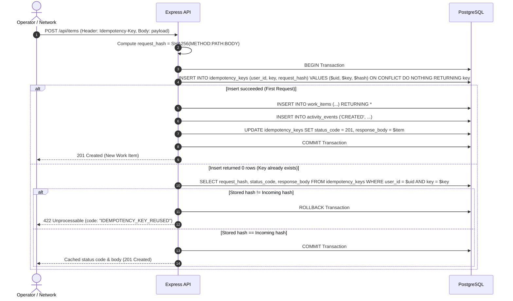

---

## 9. Asynchronous Flow: Transactional Outbox & Worker

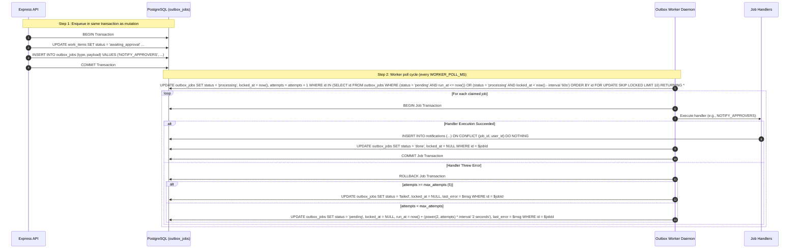

### Worker Resilience Properties
- **Transactional Atomicity**: Outbox jobs are inserted within the same database transaction as work item mutations ([items.ts](backend/src/services/items.ts)). If the mutation rolls back, no orphan job is written.
- **Concurrent Worker Isolation**: `FOR UPDATE SKIP LOCKED` guarantees that multiple worker daemons never claim or process the same outbox job.
- **Stale Lock Recovery**: If a worker crashes mid-execution, its lock expires after 60 seconds (`locked_at < now() - interval '60 seconds'`). Subsequent polling iterations automatically reclaim the job.
- **Exponential Backoff**: Transient errors trigger retries with exponential backoff calculated as $\text{now}() + (2^{\text{attempts}} \times 2\text{s})$. After 5 failed attempts (`max_attempts = 5`), the job transitions to `failed` for manual inspection.
- **Idempotent Handlers**: Notifications are inserted using `ON CONFLICT (job_id, user_id) DO NOTHING` ([notifications.ts](backend/src/services/notifications.ts)), guaranteeing that duplicate processing attempts never spawn duplicate user alerts.

---

## 10. Consistency and Concurrency Guarantees

| Situation | Mechanism | Where in Code | Test That Proves It |
| :--- | :--- | :--- | :--- |
| **Atomic Claim** | Single conditional `UPDATE ... WHERE id = $1 AND assignee_id IS NULL AND status IN ('open','in_progress')` | [backend/src/services/items.ts](backend/src/services/items.ts#L298-L310) (`claimItem`) | [backend/tests/concurrency.test.ts](backend/tests/concurrency.test.ts) (10 parallel claims result in 1 winner and 9 409s) |
| **Stale Edit Collision** | Optimistic locking checking `WHERE id = $1 AND version = $version`, incrementing `version = version + 1` | [backend/src/services/items.ts](backend/src/services/items.ts#L220-L245) (`updateItem`) | [backend/tests/version.test.ts](backend/tests/version.test.ts) (stale version returns 409 with latest snapshot) |
| **Duplicate Network Request** | Transactional `idempotency_keys` table with `UNIQUE(user_id, key)` caching status and response payload | [backend/src/services/idempotency.ts](backend/src/services/idempotency.ts#L34-L108) (`executeWithIdempotency`) | [backend/tests/idempotency.test.ts](backend/tests/idempotency.test.ts) (sequential and parallel replays execute SQL once) |
| **Workflow Governance** | Strict transition candidate table and non-self-approval validation rule | [backend/src/services/workflow.ts](backend/src/services/workflow.ts#L4-L18), [backend/src/services/permissions.ts](backend/src/services/permissions.ts#L127-L138) | [backend/tests/workflow.test.ts](backend/tests/workflow.test.ts) (invalid jumps return 422; lead cannot approve own item) |
| **Multi-Tenant Isolation** | Unified `can()` function enforcing team membership on all reads and writes; team-scoped queries | [backend/src/services/permissions.ts](backend/src/services/permissions.ts#L43-L46), [backend/src/services/items.ts](backend/src/services/items.ts#L517-L534) | [backend/tests/authz.test.ts](backend/tests/authz.test.ts) (non-member receives 403 on read, edit, claim, transition) |
| **Outbox Reliability** | Entity mutation and outbox job committed in single transaction; `FOR UPDATE SKIP LOCKED` claim | [backend/src/services/outbox.ts](backend/src/services/outbox.ts#L22-L65), [backend/src/worker/worker.ts](backend/src/worker/worker.ts#L15-L62) | [backend/tests/outbox.test.ts](backend/tests/outbox.test.ts) (idempotent notification insert and retry backoff) |
| **Append-Only History** | PostgreSQL trigger rejecting `UPDATE` or `DELETE` on `activity_events` | [backend/migrations/001_init.sql](backend/migrations/001_init.sql#L58-L69) | [backend/tests/atomicity.test.ts](backend/tests/atomicity.test.ts) (trigger aborts modification with exception) |
| **Optimistic UI Reconciliation** | TanStack Query snapshots cache on mutate, rolls back on error, and hydrates `error.current` on 409 | [frontend/src/pages/ItemDetailPage.tsx](frontend/src/pages/ItemDetailPage.tsx#L145-L182) | [frontend/src/test/optimisticRollback.test.tsx](frontend/src/test/optimisticRollback.test.tsx) (409 rolls back cache and renders conflict banner) |

---

## 11. Read Path and Scale

### Keyset Pagination (Cursor Format and Ordering)
Pagination avoids the $O(N)$ scanning penalty of `OFFSET ... LIMIT`. 
- **Ordering**: Queries are deterministically ordered by `created_at DESC, id DESC`.
- **Cursor Encoding**: Cursors are generated by [encodeCursor](backend/src/services/items.ts#L55-L57) as a base64-encoded JSON payload:
  ```json
  {"createdAt": "2026-10-18T14:19:18.633Z", "id": "f75a5f7a-0357-4a01-9e59-7bb5cf2f5864"}
  ```
- **Filter Evaluation**: The next page query jumps directly to the index boundary using:
  ```sql
  WHERE (wi.created_at < $cursorCreatedAt OR (wi.created_at = $cursorCreatedAt AND wi.id < $cursorId))
  ORDER BY wi.created_at DESC, wi.id DESC
  LIMIT $limitPlusOne;
  ```
  This guarantees sub-millisecond page loads regardless of whether querying page 1 or page 1,000.

### Server-Side Filtering & Full-Text Search
- **Filter Application**: Filters for `status`, `priority`, `type`, and `assignee` are converted directly into parameterized SQL `WHERE` clauses.
- **Search Vector**: Full-text search leverages a stored PostgreSQL generated column:
  ```sql
  search_vector TSVECTOR GENERATED ALWAYS AS (to_tsvector('english', title || ' ' || description)) STORED
  ```
  Queries match using `wi.search_vector @@ websearch_to_tsquery('english', $query)` indexed via the GIN index `idx_work_items_search_vector`.
- **Client Debounce**: The frontend debounces search input by 300ms ([AllItemsPage.tsx](frontend/src/pages/AllItemsPage.tsx)) before updating URL query parameters.

### Attention Queues & Dashboard Counts
Dashboard attention counts ([getDashboardCounts](backend/src/services/items.ts)) execute indexed `COUNT(*)` aggregations:
1. `assigned_to_me`: Uses partial index `idx_work_items_assignee_active` (`WHERE status NOT IN ('resolved', 'closed')`).
2. `unassigned_urgent`: Uses partial index `idx_work_items_unassigned_urgent` (`WHERE assignee_id IS NULL AND priority = 'urgent' AND status NOT IN ('resolved', 'closed')`).
3. `awaiting_my_approval`: Uses partial index `idx_work_items_awaiting_approval` (`WHERE status = 'awaiting_approval'`), filtering out items where the lead is the assignee.

### Activity History Scale
The `activity_events` table is indexed on `(item_id, id DESC)`. [getItemActivity](backend/src/services/activity.ts) queries history using a single-column keyset cursor (`ae.id < $cursorId LIMIT 25`). Because queries strictly filter by `item_id`, performance remains constant as the total table grows.

### Measured Performance Benchmark Numbers
The following benchmark figures were verified via PostgreSQL `EXPLAIN (ANALYZE, BUFFERS)` across a freshly seeded 50,000 work item dataset (as documented in [README.md](README.md)):

| Query Profile | Scan Strategy | Execution Time | Planning Time |
| :--- | :--- | :--- | :--- |
| **Assigned to Me** (`team_id`, `assignee_id`) | Index Scan (`idx_work_items_team_created_id`) | **0.262 ms** | 6.375 ms |
| **Unassigned Urgent Attention Card** | Partial Index Scan (`idx_work_items_unassigned_urgent`) | **0.103 ms** | 0.395 ms |
| **Awaiting My Approval Attention Card** | Partial Index Scan (`idx_work_items_awaiting_approval`) | **0.067 ms** | 0.191 ms |
| **Full-Text Search Query** (`search_vector @@ plainto_tsquery`) | Bitmap Index Scan (`idx_work_items_search_vector`) | **1.455 ms** | 0.217 ms |
| **Keyset Pagination (Page 2)** (`(created_at, id) < (cursor)`) | Index Scan (`idx_work_items_team_created_id`) | **0.079 ms** | 0.134 ms |

---

## 12. Failure Scenarios

| Failure Scenario | Immediate System Behaviour | Concrete Recovery Mechanism |
| :--- | :--- | :--- |
| **Database Unavailable** | Active queries fail. Express catches connection errors and returns HTTP 500 `{ error: { code: 'INTERNAL_SERVER_ERROR' } }`. `/api/health` returns failure. Worker poll errors are caught and logged without process termination. | `pg.Pool` automatically manages connection re-establishment upon PostgreSQL recovery. Frontend TanStack Query renders inline Error States with interactive Retry buttons without unmounting or crashing the application. |
| **Worker Crashes Mid-Job** | An in-flight job remains in `outbox_jobs` with `status = 'processing'` and `locked_at` set to the crash timestamp. The job transaction uncommitted is rolled back by PostgreSQL. | In [outbox.ts](backend/src/services/outbox.ts), `claimOutboxBatch` scans for `(status = 'processing' AND locked_at < now() - interval '60 seconds')`. Once the 60-second threshold elapses, subsequent worker poll cycles automatically reclaim and re-execute the job. |
| **Client Retries After Timeout** | The client resends the mutation with the original `Idempotency-Key`. | In [idempotency.ts](backend/src/services/idempotency.ts), `executeWithIdempotency` checks `idempotency_keys`. The existing `(user_id, key)` is fetched; matching hashes immediately return the cached status code and payload without re-executing SQL mutations. |
| **Two Users Collide (Claim or Edit)** | Both requests enter PostgreSQL concurrently. The first transaction commits successfully. The second transaction matches 0 rows in conditional `UPDATE`. | In [items.ts](backend/src/services/items.ts), the second transaction detects 0 updated rows, fetches the newly committed record snapshot, and throws `409 Conflict` (`ALREADY_CLAIMED` or `VERSION_CONFLICT`). The frontend rolls back optimistic updates and presents the conflict banner with the latest server state. |
| **Job Handler Keeps Failing** | The job handler throws an exception during processing. The job transaction rolls back. | In [worker.ts](backend/src/worker/worker.ts), the error is caught and passed to `failOrRetryOutboxJob`. If `attempts < max_attempts (5)`, the job is reset to `pending` with exponential backoff: `run_at = now() + (power(2, attempts) * interval '2 seconds')`. When attempts reach 5, the job is marked `status = 'failed'` with `last_error` recorded, preventing infinite retry loops. |

---

## 13. Frontend State Management

### Query Keys Hierarchy
TanStack Query keys are structured hierarchically to enable granular cache invalidation:
- `['item', id]`: Single work item details and `allowedActions` metadata.
- `['activity', id]`: Keyset-paginated activity event stream for an item.
- `['comments', id]`: Comment thread for an item.
- `['items', filterParams]`: Keyset-paginated item search and filter queries.
- `['dashboard']`: Attention queue metric counts (`assignedToMe`, `unassignedUrgent`, `awaitingMyApproval`).
- `['notifications']`: Current user's notification feed.
- `['teamMembers', teamId]`: Roster of eligible assignees for a team.

### Polling & Refetch Intervals
- **Dashboard Metrics & Item Lists**: Configured with `refetchInterval: 15000` (15s) and `refetchOnWindowFocus: true` to surface newly arriving incidents without manual refreshes.
- **Item Detail View**: Polled every 15s to keep version and status current.
- **Error Retries**: [frontend/src/App.tsx](frontend/src/App.tsx) configures `QueryClient` to bypass retries on client errors (`401`, `403`, `404`, `409`, `422`), only retrying transient network errors up to 2 times.

### Optimistic Updates & Rollback Flow
For high-frequency state transitions ([claimMutation](frontend/src/pages/ItemDetailPage.tsx#L138-L196) and [transitionMutation](frontend/src/pages/ItemDetailPage.tsx#L201-L245)):
1. **`onMutate`**:
   - Cancels outgoing refetches: `queryClient.cancelQueries({ queryKey: ['item', id] })`.
   - Snapshots the current cache: `previousItem = queryClient.getQueryData(['item', id])`.
   - Optimistically updates the cache (e.g., sets `assignee_id = user.id`, updates status, and increments `version = version + 1`).
2. **`onError`**:
   - Reverts cache to `context.previousItem`.
   - If error is `409 Conflict`, extracts `err.current` (fresh server snapshot returned by the backend) and hydrates the cache immediately.
   - Activates `conflictBanner`: `"This item was changed by someone else. Showing the latest version."`
3. **`onSuccess`**:
   - Clears `conflictBanner`.
   - Updates cache with the server's authoritative response.
   - Resets the ref's `idempotencyKey` to a fresh UUID for the next action.
4. **`onSettled`**:
   - Invalidates `['item', id]`, `['activity', id]`, `['items']`, and `['dashboard']` to synchronize all application views.

### Idempotency Key Generation
In [ItemDetailPage.tsx](frontend/src/pages/ItemDetailPage.tsx), idempotency keys are created using React refs:
```typescript
const claimKeyRef = useRef(crypto.randomUUID());
const transitionKeyRef = useRef(crypto.randomUUID());
const commentIdempotencyKeyRef = useRef(crypto.randomUUID());
```
- Using `useRef` ensures that user retries or re-renders send the **exact same key** for that operation.
- Upon successful mutation completion (`onSuccess`), the key is replaced with `crypto.randomUUID()` to prepare for future distinct operations.

---

## 14. Key Trade-offs & What Changes at 10x Scale

For comprehensive architecture decision records, refer to [ENGINEERING_DECISIONS.md](ENGINEERING_DECISIONS.md).

### Current Trade-offs
1. **Hand-Written SQL over ORM**: Eliminates N+1 queries, provides full control over transactional boundaries, and enables atomic `UPDATE ... RETURNING` locks at the expense of writing manual parameter bindings.
2. **PostgreSQL Outbox Table over Redis/RabbitMQ Broker**: Avoids the distributed "dual-write" problem by saving outbox jobs in the same transaction as entity changes. Introduces a light 1500ms polling load on PostgreSQL, which is mitigated via partial indexes (`idx_outbox_jobs_pending`).
3. **Optimistic Locking over Pessimistic Row Locking**: Eliminates long-held database locks and connection exhaustion when operators leave browser tabs open. Requires losing operators to re-fetch on collision (`409`).
4. **Short Polling over WebSockets**: Simplifies deployment and container orchestration by keeping the API stateless, at the cost of 15s latency for passive background updates.

### What Changes at 10x Scale (500k Active Items, 500+ Concurrent Operators)

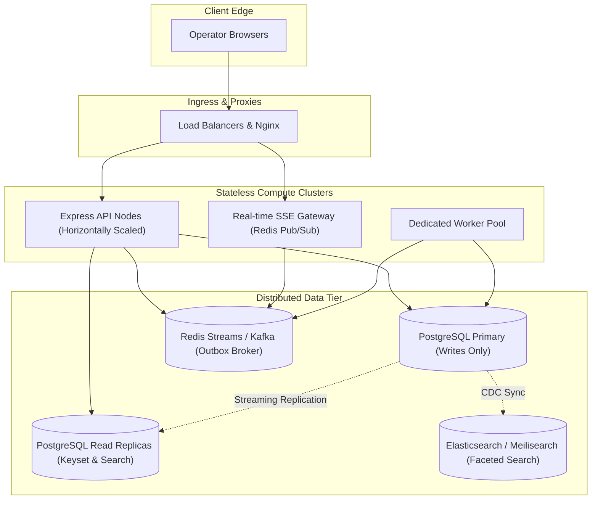

1. **PostgreSQL Read Replicas**:
   Split database traffic. Direct `GET /api/items` (keyset pagination), `GET /api/dashboard`, and search queries to read replicas via PgBouncer / Aurora reader endpoints, reserving the primary writer instance strictly for transactional mutations.
2. **Table Partitioning for Audit Events**:
   Implement declarative range partitioning on `activity_events` by month (`PARTITION BY RANGE (created_at)`). Historical audit records older than 6 months can be detached to cold storage, maintaining compact, memory-resident B-tree index trees.
3. **Dedicated Message Broker**:
   Transition the `outbox_jobs` polling loop to high-throughput message streaming via Redis Streams or Apache Kafka using Debezium Change Data Capture (CDC) from PostgreSQL write-ahead logs (WAL).
4. **Dedicated Search Engine**:
   Offload `tsvector` queries to Meilisearch or Elasticsearch to support multi-language stemmers, typo tolerance, and faceted filtering without consuming database CPU.
5. **Server-Sent Events (SSE)**:
   Replace client-side 15s polling with Server-Sent Events backed by a Redis Pub/Sub event bus, broadcasting instantaneous status stepper advancements and notification toasts to active browser sessions.

---

### Known Architecture Limitations
1. **Email Delivery**: The worker logs notification dispatches to stdout and writes records to the `notifications` table rather than routing to an external SMTP relay or third-party email API.
2. **Single Primary Database**: The container setup runs on a single PostgreSQL primary instance; production high-availability requires managed streaming replication with automatic failover.
3. **English Stemmer Default**: The generated `search_vector` uses PostgreSQL's default `english` configuration; internationalized text requires dictionary configuration.
