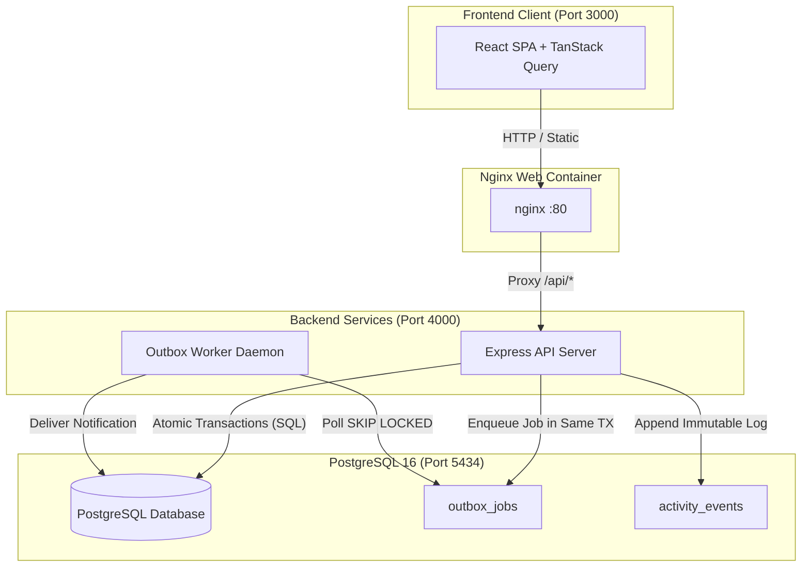
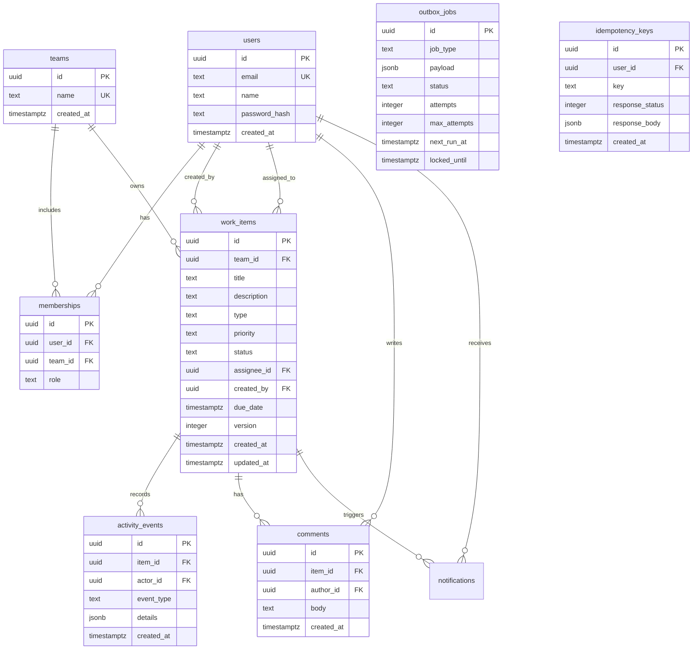
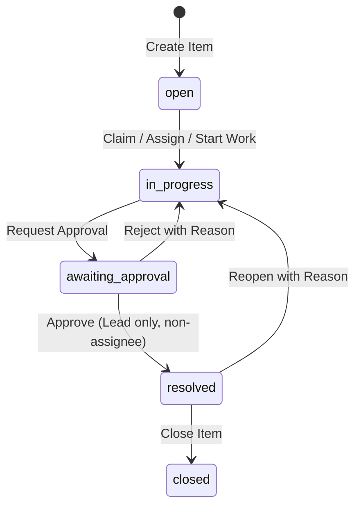

# Operations Under Pressure

A concurrency-correct, audited operations management platform for fast-moving teams to track, claim, review, and resolve high-pressure operational incidents without data corruption or lost updates.

`React 18` | `TypeScript` | `Tailwind CSS 3.4` | `TanStack Query` | `Node.js 20` | `Express` | `PostgreSQL 16` | `Docker`

Author: **<ANMOL>** | Roll No: **<2300971530027>** |   
 

---

## The Problem

High-throughput operations teams handle critical incidents across overlapping shifts and distributed queues. Without rigorous server-side concurrency guarantees, operators inadvertently race to claim identical tickets, stale form submissions silently overwrite newer updates, network retries spawn duplicate records, and loosely enforced permissions lead to horizontal escalation. Operations Under Pressure eliminates these hazards through rigorous transactional architecture and deterministic state reconciliation.

## What It Does

- **Atomic Claims**: Single-winner conditional SQL updates prevent multiple operators from claiming the same ticket concurrently.
- **Optimistic Concurrency Control (OCC)**: Explicit entity versioning stops lost updates on parallel ticket edits.
- **Transactional Idempotency**: Cryptographic idempotency keys ensure network retries and double-clicks produce exactly one mutation.
- **Enforced Workflow Governance**: Deterministic state machine requiring verified lead approval before incident resolution, forbidding self-approval.
- **Team-Scoped Multi-Tenant Authorization**: Unified permission engine ensuring viewers cannot mutate state and operators never access unauthorized team items.
- **Transactional Outbox & Worker**: Event outbox pattern decoupled from HTTP request cycles, offering at-least-once delivery with exponential backoff and idempotent handlers.
- **Optimistic UI Reconciliation**: Instant client updates with automatic cache rollback and non-destructive conflict alerts on concurrency collisions.

---

## Screenshots

The screenshots below illustrate key platform flows. Place image captures in `docs/screenshots/`:

| Dashboard & Attention Queues | All Items & Keyset Search |
| :---: | :---: |
|  |  |
| *Live count cards, active filters, and queue selection* | *Server-side full-text search and keyset pagination* |

| Item Detail & Audit Timeline | Concurrency Conflict Reconciliation |
| :---: | :---: |
|  |  |
| *Workflow stepper, allowed actions, and immutable history* | *409 OCC collision banner with draft preservation* |

---

## Quick Start

### Prerequisites
- [Docker Desktop](https://www.docker.com/products/docker-desktop/) installed and running.
- [Node.js 20+](https://nodejs.org/) (required only if running tests locally without Docker).

### Setup & Run
1. Clone the repository and navigate to the root directory:
   ```bash
   git clone <GITHUB PROFILE LINK>/newtonite-ops.git
   cd newtonite-ops
   ```
2. Start the entire containerized stack with a single command:
   ```bash
   docker compose up --build
   ```
3. Access the services:
   - **Web Interface**: [http://localhost:3000](http://localhost:3000)
   - **Backend API**: [http://localhost:4000](http://localhost:4000)
   - **API Health Check**: [http://localhost:4000/api/health](http://localhost:4000/api/health)
   - **PostgreSQL Database**: `localhost:5434` (`user: ops`, `password: ops`, `database: ops`)

### Demo Accounts
All demo accounts share the password: `Demo@12345`. Each demonstrates specific authorization boundaries:

| Email | Role | Assigned Teams | Recommended Demonstration Flow |
| :--- | :--- | :--- | :--- |
| `admin@demo.dev` | Admin | All 4 Teams | Global cross-team visibility, reassignment of tickets, notifications popover. |
| `lead.payments@demo.dev` | Lead | Payments Ops | Approving or rejecting items in `awaiting_approval`, team member assignment. |
| `member.payments@demo.dev` | Member | Payments Ops | Creating tickets, claiming unassigned items, requesting approval, commenting. |
| `lead.support@demo.dev` | Lead | Customer Support | Verifying team isolation: cannot see or mutate Payments Ops tickets. |
| `viewer@demo.dev` | Viewer | Payments & Support | Read-only role: action buttons disabled, server rejects mutations with 403. |
| `multi@demo.dev` | Multi-role | Payments (Lead), Compliance (Member), Platform (Viewer) | Dynamic multi-team permission evaluation depending on item context. |

---

## Running the Tests

Execute all backend integration tests using the single root command:
```bash
npm test
```

### What the Test Suite Covers
- **Concurrency**: 10 parallel HTTP claim requests competing for one ticket produce exactly one 200 OK and nine 409 Conflicts.
- **Optimistic Locking**: Stale version update attempts return 409 with the fresh server version; correct versions increment cleanly.
- **Idempotency**: Duplicate requests sequentially or in parallel return identical cached responses and execute SQL mutations once.
- **Workflow State Machine**: Invalid transitions return 422; member approval returns 403; lead cannot self-approve own item.
- **Authorization**: Cross-team read/write blocked with 403; list endpoint strictly isolates records by caller membership.
- **Append-Only History**: PostgreSQL triggers reject UPDATE/DELETE on `activity_events`; transactional rollback aborts item mutations if event logging fails.
- **Outbox Worker**: Deduplicated idempotent handler execution; failed jobs retry up to `max_attempts` with exponential backoff.
- **Keyset Pagination**: 120 items queried with limit 50 yield three non-overlapping, gapless pages.
- **Optimistic UI Rollback**: Claim conflict rollbacks cached item data and displays latest server state.

### Try the Critical Behaviours Yourself
Run the live concurrency and race condition demonstration script with one command:
```bash
npm run demo:concurrency
```
This script authenticates multiple seeded operator accounts, fires 10 simultaneous claims at the exact same work item, sends 5 duplicate creation requests with the same idempotency key in parallel, and attempts a stale version update, printing a real-time summary of concurrency resolution.

---

## Architecture



### Request and Async Processing Flow
1. **Synchronous Mutation Flow**: Client issues requests carrying JWT authentication and a unique `Idempotency-Key` header. Express middleware validates credentials, checks the idempotency store, and executes the mutation inside an atomic PostgreSQL transaction.
2. **Accountable State Change**: Every update writes to `work_items`, appends an immutable entry to `activity_events`, writes any notification to `outbox_jobs`, and caches the response in `idempotency_keys` in the same transaction.
3. **Asynchronous Outbox Processing**: The background worker polls `outbox_jobs` using `SELECT ... FOR UPDATE SKIP LOCKED`. Handlers process events idempotently, record completion, or schedule exponential backoff retries on error.

For comprehensive architectural specifications, sequence diagrams, and concurrency guarantees, see [ARCHITECTURE.md](ARCHITECTURE.md).

---

## Critical Behaviours

| Behaviour | Problem It Prevents | How It Works (One Line) | Code Location | Test Location |
| :--- | :--- | :--- | :--- | :--- |
| **Atomic Claim** | Dual operator assignment race conditions | Conditional SQL `UPDATE work_items SET assignee_id = $1 WHERE id = $2 AND assignee_id IS NULL` | [items.ts](file:///c:/Users/HP/newtonite-ops--2300971530027-/backend/src/services/items.ts#L104-L125) | [concurrency.test.ts](file:///c:/Users/HP/newtonite-ops--2300971530027-/backend/tests/concurrency.test.ts) |
| **Optimistic Locking** | Lost updates from concurrent edits | Compares client `version` in SQL `WHERE version = $version` and increments on success, throwing 409 on mismatch | [items.ts](file:///c:/Users/HP/newtonite-ops--2300971530027-/backend/src/services/items.ts#L71-L100) | [version.test.ts](file:///c:/Users/HP/newtonite-ops--2300971530027-/backend/tests/version.test.ts) |
| **Transactional Idempotency** | Duplicate mutations on network retries or double clicks | Atomic `ON CONFLICT (user_id, key)` lock and payload cache within the same database transaction | [idempotency.ts](file:///c:/Users/HP/newtonite-ops--2300971530027-/backend/src/services/idempotency.ts#L22-L78) | [idempotency.test.ts](file:///c:/Users/HP/newtonite-ops--2300971530027-/backend/tests/idempotency.test.ts) |
| **Workflow Governance** | Unauthorized status advancement or self-approval | Strict transition state table and authorization rule preventing assignees from approving their own work | [workflow.ts](file:///c:/Users/HP/newtonite-ops--2300971530027-/backend/src/services/workflow.ts#L4-L26) | [workflow.test.ts](file:///c:/Users/HP/newtonite-ops--2300971530027-/backend/tests/workflow.test.ts) |
| **Resource-Level Authz** | Cross-tenant horizontal privilege escalation | Single `can(user, action, item)` gate evaluating team memberships before any DB operation | [permissions.ts](file:///c:/Users/HP/newtonite-ops--2300971530027-/backend/src/services/permissions.ts#L31-L120) | [authz.test.ts](file:///c:/Users/HP/newtonite-ops--2300971530027-/backend/tests/authz.test.ts) |
| **Transactional Outbox** | Distributed dual-write failure between DB and notifications | Outbox records written within the entity transaction; worker consumes with `FOR UPDATE SKIP LOCKED` | [worker.ts](file:///c:/Users/HP/newtonite-ops--2300971530027-/backend/src/worker/worker.ts#L47-L85) | [outbox.test.ts](file:///c:/Users/HP/newtonite-ops--2300971530027-/backend/tests/outbox.test.ts) |
| **UI State Reconciliation** | Stale local views after concurrency conflicts | TanStack Query snapshots cache on mutate, rolls back on error, and hydrates latest state on 409 | [ItemDetailPage.tsx](file:///c:/Users/HP/newtonite-ops--2300971530027-/frontend/src/pages/ItemDetailPage.tsx#L145-L182) | [optimisticRollback.test.tsx](file:///c:/Users/HP/newtonite-ops--2300971530027-/frontend/src/test/optimisticRollback.test.tsx) |

---

## Data Model



---

## Workflow State Machine & Permissions

### State Transitions


### Role Authorization Matrix

| Action | Viewer | Member | Lead | Admin |
| :--- | :---: | :---: | :---: | :---: |
| **Read Items & Activity** | Allowed | Allowed | Allowed | Allowed |
| **Create Item** | Denied | Allowed | Allowed | Allowed |
| **Claim Item** | Denied | Allowed (if unassigned) | Allowed (if unassigned) | Allowed (if unassigned) |
| **Assign / Reassign** | Denied | Denied | Allowed | Allowed |
| **Edit Details** | Denied | Allowed (Assignee/Creator only) | Allowed | Allowed |
| **Comment** | Denied | Allowed | Allowed | Allowed |
| **Request Approval** | Denied | Allowed (Assignee) | Allowed (Assignee) | Allowed |
| **Approve Item** | Denied | Denied | Allowed (Non-assignee) | Allowed |
| **Close / Reopen** | Denied | Denied | Allowed | Allowed |

---

## API Reference

| Method | Path | Purpose | Required Role |
| :--- | :--- | :--- | :--- |
| `POST` | `/api/auth/login` | Authenticate user and issue signed JWT | Public |
| `GET` | `/api/me` | Fetch authenticated user profile & team memberships | Authenticated |
| `GET` | `/api/health` | Container healthcheck probe | Public |
| `GET` | `/api/teams/:id/members` | List members and roles for a specific team | Team Member+ |
| `GET` | `/api/items` | Keyset-paginated search and filter across caller's teams | Team Member+ |
| `POST` | `/api/items` | Create new work item (requires `Idempotency-Key`) | Member / Lead / Admin |
| `GET` | `/api/items/:id` | Fetch single item with dynamic `allowedActions` UI hints | Team Member+ |
| `PATCH` | `/api/items/:id` | Update mutable item fields with OCC `version` check | Assignee / Lead / Admin |
| `POST` | `/api/items/:id/claim` | Atomically claim unassigned item (`Idempotency-Key`) | Member / Lead / Admin |
| `POST` | `/api/items/:id/assign` | Assign/reassign item to eligible team member | Lead / Admin |
| `POST` | `/api/items/:id/transition`| Advance workflow state with `to` and `version` | Role-governed |
| `GET` | `/api/items/:id/activity` | Keyset-paginated append-only audit trail | Team Member+ |
| `GET` | `/api/items/:id/comments` | Fetch comments for an item | Team Member+ |
| `POST` | `/api/items/:id/comments` | Post comment (`Idempotency-Key` supported) | Member / Lead / Admin |
| `GET` | `/api/dashboard` | Aggregated attention cards (`assigned`, `unassigned_urgent`, `awaiting_approval`) | Team Member+ |
| `GET` | `/api/notifications` | Fetch unread and recent notifications for caller | Authenticated |
| `POST` | `/api/notifications/read-all` | Mark all notifications read for caller | Authenticated |

---

## Scale and Performance

- **Keyset Pagination**: Pagination avoids `OFFSET` performance degradation. Queries sort by `(created_at, id)` and fetch pages with `WHERE (created_at, id) < (cursor_created_at, cursor_id) LIMIT 50`, delivering constant O(1) query performance across millions of rows.
- **Indexes**:
  - `idx_work_items_team_created_id`: Composite B-tree index on `(team_id, created_at DESC, id DESC)` for zero-offset keyset pagination and team queue filtering.
  - `idx_work_items_team_status_created_id`: Composite index on `(team_id, status, created_at DESC, id DESC)` for fast status filtering.
  - `idx_work_items_unassigned_urgent`: Partial B-tree index on `(team_id, created_at DESC, id DESC)` `WHERE assignee_id IS NULL AND priority = 'urgent' AND status NOT IN ('resolved', 'closed')` powering instant attention cards.
  - `idx_work_items_awaiting_approval`: Partial index on `(team_id, created_at DESC, id DESC)` `WHERE status = 'awaiting_approval'` for lead review queues.
  - `idx_work_items_search_vector`: GIN index on generated `search_vector` column supporting fast indexed full-text search.
- **Strict Server-Side Processing**: No sorting, filtering, or pagination is performed in browser memory; the backend applies all boundaries before transmitting payloads.

### Performance Notes (Measured at 50,000 Records)
Real execution timings measured via PostgreSQL `EXPLAIN (ANALYZE, BUFFERS)` across a freshly seeded 50,000 work item dataset (executed on an x86_64 host running Windows 11 with PostgreSQL):

| Query Profile | Scan Strategy | Execution Time | Planning Time |
| :--- | :--- | :--- | :--- |
| **Assigned to Me** (`team_id`, `assignee_id`) | Index Scan (`idx_work_items_team_created_id`) | **0.262 ms** | 6.375 ms |
| **Unassigned Urgent Attention Card** | Partial Index Scan (`idx_work_items_unassigned_urgent`) | **0.103 ms** | 0.395 ms |
| **Awaiting My Approval Attention Card** | Partial Index Scan (`idx_work_items_awaiting_approval`) | **0.067 ms** | 0.191 ms |
| **Full-Text Search Query** (`search_vector @@ plainto_tsquery`) | Bitmap Index Scan (`idx_work_items_search_vector`) | **1.455 ms** | 0.217 ms |
| **Keyset Pagination (Page 2)** (`(created_at, id) < (cursor)`) | Index Scan (`idx_work_items_team_created_id`) | **0.079 ms** | 0.134 ms |

*Machine caveat*: Benchmarks were captured on local NVMe SSD storage with PostgreSQL running locally. Actual execution latency in cloud environments will vary based on network round-trip time (RTT), available vCPU memory, and connection pool sizing.

---

## Failure Scenarios & System Resilience

- **Database Connectivity Loss**: The connection pool detects disconnections, Express returns structured 500 error envelopes (`{ error: { code: 'INTERNAL_ERROR' } }`), and the frontend displays a resilient Error State with a Retry button without crashing.
- **Worker Crash Mid-Job**: The worker acquires jobs using `FOR UPDATE SKIP LOCKED` and sets `locked_until = now() + 2 minutes`. If the worker crashes mid-execution, the lock expires automatically and a subsequent worker iteration safely retries the job.
- **Client Duplicate Retries**: When network delays trigger client retries or operators double-click submission buttons, the transaction detects the existing `(user_id, idempotency_key)` record and immediately returns the cached HTTP response without re-executing business logic.
- **Concurrent Operator Collision**: If two operators attempt to modify an item simultaneously, the second transaction detects a version conflict (`WHERE version = $version` matched 0 rows) and throws `409 VERSION_CONFLICT`, returning the current database state so the client can reconcile without data loss.

---

## Project Structure

```text
newtonite-ops/
├── backend/
│   ├── migrations/              # Incremental SQL migrations
│   ├── src/
│   │   ├── db/                  # Pool connection, migration runner, seed script
│   │   ├── middleware/          # JWT auth, error handling
│   │   ├── routes/              # Express API routers (auth, items, dashboard, etc.)
│   │   ├── services/            # Business logic: items, workflow, permissions, idempotency
│   │   ├── worker/              # Outbox background processing daemon
│   │   ├── app.ts               # Express application factory
│   │   ├── server.ts            # API server entrypoint
│   │   └── config.ts            # Environment configurations
│   ├── tests/                   # Vitest integration test suite (20 tests)
│   └── Dockerfile               # Multi-stage production container build
├── frontend/
│   ├── src/
│   │   ├── api/                 # Typed API client with JWT and error parsing
│   │   ├── components/          # Reusable UI components, modals, stepper, badges
│   │   ├── context/             # AuthContext, ToastContext
│   │   ├── pages/               # LoginPage, DashboardPage, AllItemsPage, ItemDetailPage
│   │   └── test/                # Vitest optimistic update rollback test
│   ├── nginx.conf               # Production SPA reverse proxy and routing
│   └── Dockerfile               # Multi-stage Vite build and Nginx runner
├── docs/screenshots/           # UI demonstration assets
├── docker-compose.yml           # Orchestration for db, api, worker, and web
├── package.json                 # Root script definitions
├── ARCHITECTURE.md              # Technical architecture, sequence diagrams, and specifications
├── ENGINEERING_DECISIONS.md     # Architectural and engineering rationale
└── README.md
```

Detailed architectural specifications and sequence diagrams are in [ARCHITECTURE.md](ARCHITECTURE.md), and design trade-offs are documented in [ENGINEERING_DECISIONS.md](ENGINEERING_DECISIONS.md).

---

## Known Limitations

- **Email Delivery**: The outbox worker logs external email alerts to standard output rather than routing through an external SMTP or SendGrid provider.
- **Full Text Search Locale**: Full-text search leverages PostgreSQL's standard `english` dictionary; multilingual stemming requires dictionary extension.
- **Synchronous WebSocket Absence**: Real-time dashboard updates rely on TanStack Query short polling (15–20s) rather than bidirectional WebSockets.

## With Another Week I Would

1. **Server-Sent Events (SSE)**: Implement SSE endpoints for instant live notification and ticket status broadcasts without polling overhead.
2. **Read Replica Splitting**: Route keyset pagination and search queries to PostgreSQL read replicas to reserve the primary instance for transactional writes.
3. **Partitioning on Activity Events**: Implement table partitioning on `activity_events` by month to maintain index efficiency as audit records reach millions of rows.
